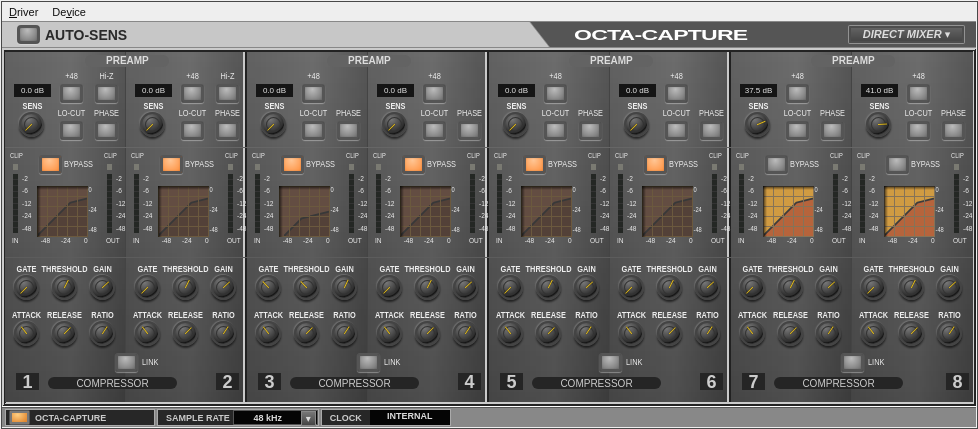
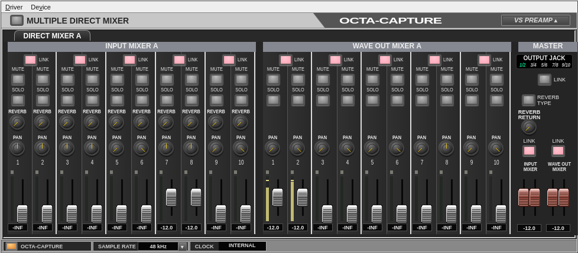

# octa-capture

Linux driver and control panel for the **Roland OCTA-CAPTURE / UA-1010**
(`0582:0120`). The target is native Debian. Original project code is **GPL-2.0-only**.

The standalone ALSA module supports all four descriptor rates and separates MIDI
from CTRL. Debian users load `snd-octa-capture`; they do not patch their kernel.
The HTML panel runs against a real C++ backend and also embeds in GTK4/WebKitGTK.
It includes eight preamp/compressor strips, four mixers, routing, reverb,
Auto-Sens, settings import/export, device selection and live MIDI/PCM meters.
Nonlinear parameter tables and display math are checked against both original
Windows and macOS binaries.

## Screenshots

The Linux GTK4/WebKitGTK panel connected to an OCTA-CAPTURE on native Debian.

**Preamps and compressors**



**Direct Mixer**



## Run the panel

```bash
make release
python3 tools/serve-gui.py --open
# Development binaries: add --bin-dir build/strict
```

Use an account with ALSA device access. The server binds only to `127.0.0.1`;
open its private launch link. Token authentication, Host/Origin checks and a
local-only content policy protect device operations. Audio stays in the kernel
and continues when the panel closes.
External synchronization permits only the current rate; unavailable clock
status disables rate selection.

For the desktop window on Debian 13 (GTK 4.10 or later):

```bash
sudo apt install python3-gi python3-xlib gir1.2-gtk-4.0 gir1.2-webkit-6.0
python3 tools/desktop-gui.py
```

The GTK host keeps the WebKit sandbox enabled, blocks external navigation and
uses native file dialogs. Right-click the panel's device name, press Shift+F10
or use Driver Settings to select a discovered unit. Serial identities survive
ALSA card renumbering, with automatic same-unit reconnection.

## Build and install

For Debian 13 amd64, the combined package installs the GUI, device tools,
Linux 6.12 DKMS sources, hotplug activation and the regular-user stereo-pair
service. It uses the same unprivileged `sbuild` workflow as the local btop
package; see [the Debian build guide](debian/README.source).

```bash
python3 tools/build-debian.py --jobs 2
sudo apt install ./build/debian-trixie/octa-capture_*_amd64.deb
```

The package configures the driver on installation and after reconnecting the
device. GUI and audio services run as the desktop user. Existing settings and
presets are retained. DKMS builds only the external module for matching headers.
Installed commands have manual pages, including `man octa-capture` and
`man octa-capture-activate`.

Userspace uses C++23, CMake/Ninja, LLVM 19, ALSA and libusb; kernel additions use
C/Kbuild. Development packages include `clang-19`, `clang-tidy-19`,
`clang-format-19`, `libclang-rt-19-dev`, `build-essential`, `cmake`, `ninja-build`,
`pkg-config`, `libusb-1.0-0-dev`, `libasound2-dev`, `alsa-utils`, `shellcheck`,
`python3`, `nodejs`, `node-undici` and `eslint`. Browser checks use `chromium`.

```bash
make test       # strict warnings, clang-tidy, ASan/UBSan and offline tests
make lint       # formatting and full native static analysis
make release    # optimized build and tests
cmake --install build/release --prefix "$HOME/.local"
~/.local/bin/octa-capture
# HTTP-only launcher: ~/.local/bin/octa-capture-http --open
```

[Kernel and Debian/DKMS instructions](kernel/README.md) cover matching headers,
module activation and packages. `VERSION` controls CMake/CPack versions. The
runtime package includes both GUI launchers, device tools and an OCTA-CAPTURE
entry under **Applications → Settings** in Xfce.
The DKMS package builds only the external module for its supported kernel
series.

Experimental `octa-aggregate` preparation and its physical-test limits are
described in the [kernel guide](kernel/README.md#experimental-two-unit-alsa-configuration).

For native PulseAudio, run `octa-pulse-pairs --install` as your regular user to
enable five Playback and six Recording stereo pairs, including Recording 11-12.
The user service installs device-specific ALSA `dshare`/`dsnoop` definitions and
a PulseAudio stereo profile; unrelated ALSA settings remain intact. Desktop
stereo audio stays on its selected pair, with no surround upmix or duplicate
multichannel endpoint. Applications needing the full interleaved stream can
still access ALSA directly after PulseAudio releases the device.

The GUI coordinates sample-rate changes with PulseAudio: streams are briefly
paused, the card is reopened at the requested rate, then pair assignments,
volumes and mute states are restored. At 192 kHz, only Playback/Recording 1-2
and 3-4 exist. Stop active streams on higher pairs before switching to 192 kHz.
Native PulseAudio 17 passes application rate changes at all four rates; other
ALSA clients must release their streams themselves. PipeWire integration remains
unverified. Starting the helper initially may briefly interrupt device audio.

For native Debian development, first build `build/driver-native/snd-octa-capture.ko`
against the running 6.12 kernel, then run `sudo ./tools/setup-native-dev.sh`.
This installs development tools, grants the invoking user device access and
configures the existing bounded module helper. USB monitor access is limited to
the connected device's bus and must be renewed after reboot.

## Verification

Native userspace builds retain strict warnings, stack and stack-clash protection,
Fortify 3, libstdc++ assertions, full RELRO and a non-executable stack. CMake
requires PIE support and builds executables as PIE; Linux/x86 builds also use
`-fcf-protection=full`. Sanitizer presets add their instrumentation to this
baseline. The kernel module uses only Kbuild's own hardening settings.

Hardware checkers are read-only by default unless their purpose explicitly
requires streaming. `--write` checks change device parameters and use recovery
snapshots. Power switching and persistent memory require separate attention;
a runtime backup cannot undo an overwritten device-memory preset.

```bash
./build/strict/octa-state             # complete CTRL state
./build/strict/octa-status            # kernel-owned clock status
python3 tools/check-status.py --stress --binary build/strict/octa-status
python3 tools/check-bridge.py --din-isolation  # close GUI first; quiet DIN, no DIN transmission
python3 tools/check-preamps.py --write       # active channels at the current rate
./build/strict/octa-audio-check 48000 capture  # quiet, timed transfer
python3 tools/check-pcm-meters.py --rates    # quiet meter/PCM lifecycle checks
python3 tools/check-mixer-audio.py --write --rates --keep-going  # digital DSP/signal checks
python3 tools/check-mixer-audio.py --write --rates --integrity-seconds 10 --aperiodic \
  --period-size 256 --buffer-size 1024      # verify actual buffers and unique digital sample alignment
./tools/check-gui.sh                        # running-panel browser checks
```

Add `--realtime` to the digital mixer checker to request bounded RTKit
`SCHED_RR` priority 5 for both ALSA utilities. This optional mode needs `rtkit`
and `python3-gi`; it runs as the regular user. The checker records actual
scheduling and rejects lost realtime policy, XRUNs and sample mismatches.

Fuzzing is separate from standard tests and runs only on explicit user request.
The `tools/fuzz*.sh` scripts use the dedicated `fuzz` preset with LLVM libFuzzer
and ASan/UBSan; for example, `./tools/fuzz.sh 120` runs offline protocol fuzzing
for 120 seconds. They send no malformed traffic to hardware. Kernel code retains
separate Kbuild/Sparse checks; host fuzzing does not replace kernel sanitizers,
USB fault injection or physical lifecycle tests.

## References

[USB/MIDI protocol](doc/usb-midi-protocol.txt), [GUI/backend](doc/gui-backend.md),
[PCM meters](doc/pcm-meters.md), [preset format](doc/preset-format.txt) and
[Windows GUI inspection](doc/windows-gui-inspection.txt) describe recovered
behavior, commands and evidence limits.

Official manufacturer downloads are listed in [the manifest](doc/drivers-manifest.json)
and [checksums](doc/SHA256SUMS). Downloads, extracted assets and decompilation
remain local references and are excluded from Git and releases. The interface
ships our own assets. Manufacturer files retain their original terms; see
[LICENSE](LICENSE) for project code.
